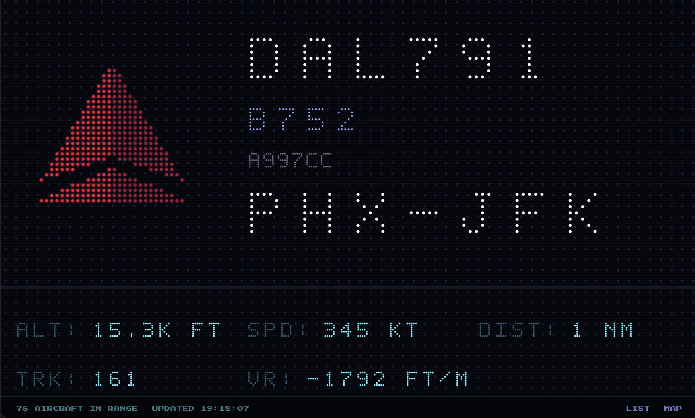

# In-Plane-Sight

Show the aircraft flying overhead, updating in real time.



There are three browser views: the main page (shown above), a list (below), and
a live map.

| Path     | View                        |
| -------- | --------------------------- |
| `/`      | LED-style information board |
| `/list`  | List of aircraft            |
| `/map`   | Map with aircraft positions |
| `/track` | Track one flight            |


It also looks great on a phone!

By default, aircraft positions come from adsb.fi, with adsb.lol as a fallback. No account or API key is needed.

## Getting Started

### Requirements

- [uv](https://docs.astral.sh/uv/)

### Install

```sh
git clone https://github.com/StellarStorm/In-Plane-Sight.git
cd In-Plane-Sight
uv sync
```

### Configure

Copy the example configuration and edit it:

```sh
cp config.example.toml config.toml
```

At minimum, set your location and search radius:

```toml
lat = 40.7128
lon = -74.0060
radius_nm = 20
```

Every setting is optional. Without a `config.toml`, the defaults below are used.

| Setting            | Default           | Description                                   |
| ------------------ | ----------------- | --------------------------------------------- |
| `lat`, `lon`       | New York City     | Center of the search area.                    |
| `radius_nm`        | `20`              | Search radius in nautical miles.              |
| `source`           | `"internet"`      | ADS-B source. `local` is not yet implemented. |
| `refresh_seconds`  | `15`              | How often aircraft data is refreshed.         |
| `time_format`      | `"24"`            | `"12"` or `"24"` hour clock.                  |
| `font_thickness`   | `"normal"`        | LED font weight: `normal` or `broad`.         |
| `aircraft_type_format` | `"code"`      | `code` (e.g. `B738`) or `description` (e.g. `BOEING 737-800`). |
| `flicker_enabled`  | `true`            | LED flicker effect.                           |
| `flicker_strength` | `0.1`             | Flicker amount, from 0 to 0.4.                |
| `host`, `port`     | `0.0.0.0`, `8000` | Address the server listens on.                |
| `log_level`        | `"INFO"`          | Python logging level.                         |

The app will not start if `config.toml` contains an unknown setting or an invalid value. The error message lists each problem by setting name.

#### Overriding settings with environment variables

Any setting can be overridden at run time with an environment variable. Use the `IPS_` prefix and upper case:

```sh
IPS_RADIUS_NM=30 IPS_TIME_FORMAT=12 IPS_PORT=9000 python main.py
```

This also works for the `[swift]` settings, for example `IPS_SWIFT_PASSWORD` or `IPS_SWIFT_CA_DIR`.

Environment variables take precedence over `config.toml`.

### Run

```sh
source .venv/bin/activate
python main.py
```

Open `http://localhost:8000/` in a browser.

### Tests

```sh
uv run pytest
```

## Tracking a Flight

The board can follow one flight anywhere in the world instead of the aircraft overhead. Open `/track` on any device on the same network (a phone works well), enter the flight, and every display switches to it on its next refresh. Anyone who can open the page can start or stop tracking.

- Enter a flight number (`UA1234`), callsign (`UAL1234`) or tail number (`N12345`). Flight numbers from common airlines are converted to the callsign the aircraft broadcasts. Regional flights often broadcast the operating airline's callsign instead, such as `ENY3456` for an American Eagle flight, so enter that if the flight is not found.
- Opening `/?track=UA1234` also starts tracking. This is handy for a bookmark or a kiosk start-up script.
- The board shows the flight with its status (waiting, on the ground, climbing, cruising, descending, signal lost or arrived). `/list` keeps showing the aircraft overhead.
- Climbing, cruising and descending describe the stage of the flight, not just the moment. Short level-offs during the climb still show as climbing. Once the descent has begun, level segments on the way down, such as holding for traffic, still show as descending. A descent has begun when the aircraft is 5,000 ft (or, for low flights, a third of its cruise altitude) below its highest altitude, or, for airliners and other flights that cruise above 18,000 ft, as soon as it descends below 18,000 ft. A level segment lasting more than 10 minutes counts as a new cruise level instead, unless an airliner is holding below 18,000 ft or route data shows the flight is within 150 nm of its destination.
- `/map` shows only the tracked flight and follows it. A solid line shows the path it has flown since tracking started. The server records this path, so opening or reloading the map shows all of it. The free ADS-B services have no history, so the path before tracking started can't be shown. With route data enabled, dashed lines join the origin to the start of the path and the aircraft to its destination.
- Before the flight appears on ADS-B (for example, before departure), the board shows it as waiting.
- Only one flight is tracked at a time. Starting a new one replaces it.

Tracking ends on its own, so a kiosk never stays stuck on an old flight. These settings control when:

```toml
[tracking]
arrived_minutes = 5  # stay on screen this long after landing
lost_minutes = 30    # give up after this long without ADS-B
max_hours = 24       # never track longer than this
```

Losing the signal while descending within 5 nm of an airport, and less than 1,500 ft above it, counts as a landing, because ADS-B coverage is often poor near the ground. Losing it anywhere else counts as signal lost, so a low flight that flies out of coverage is not mistaken for a landing.

Tracked flights are always looked up on adsb.fi (falling back to adsb.lol), even when `source = "local"`, because a local receiver only sees nearby aircraft.

## Route Data (Optional)

Route data is not required for the flight pages to be displayed. All information except the origin and destination airports will be visible.

However, route info is really cool! Getting access takes a few minutes, but is mostly painless. Each aircraft's origin and destination come from the FAA SWIM Flight Data Publication Service (FDPS) Flight FIXM feed, via the SWIM Cloud Distribution Service (SCDS). The routes are added to the `/aircraft` response and appear in the LED, list, and map views. This is something you will have to sign up for yourself, but it's free and takes only a few minutes to get approval.

### Signing Up for the Feed

1. Create an account on the SWIFT Portal at <https://portal.swim.faa.gov>.
2. Create a new SCDS subscription and choose the FDPS Flight data service. You can add message filters at this step (see [Choosing Message Filters](#choosing-message-filters)).
3. Sign the Service Access Agreement when the portal asks for it. The subscription is not provisioned until the agreement is in place.
4. When the subscription is active, open its details in the portal and copy the connection settings: host, message VPN, queue name, username and password.

The FAA's current instructions are at <https://www.faa.gov/air_traffic/technology/swim/swift-portal-on-boarding-instructions>. For portal or connection problems, see <https://support.swim.faa.gov>.

### Choosing Message Filters

The app only needs each flight's origin and destination, which do not change during a flight. Track messages repeat every few seconds for every airborne flight and use far more CPU than the app needs. These message types arrive only a few times per flight, so they can be subscribed for every source facility (`ALL`):

| Message type                    | Why                                       |
| ------------------------------- | ----------------------------------------- |
| Departure Information           | Adds the route when the flight takes off. |
| Flight Arrival Information      | Removes the route when the flight lands.  |
| Cancellation Information        | Removes cancelled flights.                |
| Flight Plan Update Information  | Picks up diversions and route changes.    |
| Flight Amendment Information    | Picks up diversions and route changes.    |

A flight that took off before the app first started has no route until it lands. Routes are saved across restarts (see below), so this only matters the first time. To cover overhead flights straight after a restart, you can also add track messages for just the en route centres around you (for example `ZNY` near New York). `Track Messages - 1 Min Update` is much lighter than `Track Messages - ALL`.

### Enabling Route Data

Install the optional dependency:

```sh
uv sync --extra swift
```

Add a `[swift]` section with the subscription details at the end of `config.toml`:

```toml
[swift]
host = "tcps://ems1.swim.faa.gov:55443"
vpn = "FDPS"
queue = "your-queue-name"
username = "your-subscription-username"
password = "your-subscription-password"
# route_ttl_hours = 20
```

Route data is enabled whenever the `[swift]` section is present. `queue`, `username` and `password` are required. If any are missing or empty, the app still starts, but with route data turned off, and it logs a warning listing what to fill in. `host` and `vpn` default to the values shown.

You can leave `password` out of the file and set it with the `IPS_SWIFT_PASSWORD` environment variable instead.

The broker's certificate is checked against the Mozilla root certificates installed with the app, so there is nothing to set up. If your network inspects TLS traffic with its own root certificate, set `ca_dir` in `[swift]` to a folder holding that certificate as a `.pem` file.

### Behaviour and Limitations

- The app reads from your persistent queue. Do not run another consumer, such as the FAA Jumpstart kit, on the same queue at the same time.
- Routes are saved to `.in-plane-sight/routes.json` every minute and when the app stops, and restored when it starts, so a restart does not lose them. Restored routes keep the time the FAA last updated them and expire on the same schedule. Live FAA data always wins: a new message for the same flight replaces its restored route, a finished flight's route is removed, and if a different flight uses the same callsign, only the live route is shown. Delete the file to start with no routes.
- A route expires `route_ttl_hours` (default 20) after the FAA last sent a message about the flight. Looking a route up does not extend it. Expired routes are removed every minute. If you subscribe only to departure messages, keep this longer than the longest flight that may pass overhead; otherwise its route expires before it arrives.
- With `log_level = "DEBUG"`, each `/aircraft` request logs how many aircraft had a known route and how many routes are stored.
- SCDS does not provide aircraft positions. Positions always come from the ADS-B source.
- If a callsign matches more than one route, no route is shown.

## Data Use

The FAA states that SCDS data is for informational use only. It must not be used for operational or aviation safety decisions. Access is governed by the FAA Service Access Agreement, and you are responsible for keeping to its terms.
